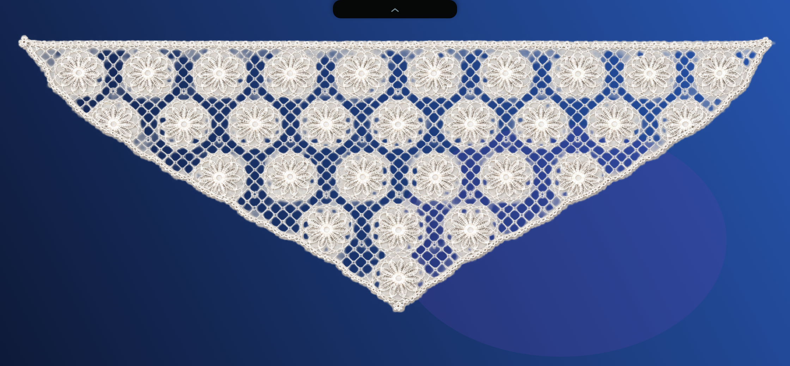

# LaceDrop

LaceDrop, macOS masaüstünün üst kenarına fizik tabanlı, etkileşimli bir dantel yerleştirir. Danteli panjur gibi açabilir, bir noktasından çekip bırakabilir ve dört farklı motif arasında geçiş yapabilirsiniz.



## Özellikler

- Metal ile gerçek zamanlı render edilen kumaş ağı
- Verlet entegrasyonu ve yay kısıtlarıyla doğal dantel hareketi
- Panjur benzeri açılma, kilitlenme ve alt uçtan çekince yukarı sarılma
- Dantelin açılma oranına bağlı masaüstü bulanıklığı
- Klasik Çiçek, Osmanlı Lalesi, Sarmaşık ve Yaprak, Geometrik Baklava motifleri
- Motif tercihini sonraki açılışlar için kaydetme
- Şeffaf, tıklamaları masaüstüne geçiren pencere
- Birden fazla monitör desteği
- Ayrı macOS ekran koruyucu modülü
- İnternet, hesap, ekran kaydı veya erişilebilirlik izni gerektirmez

## Gereksinimler

- macOS 13 Ventura veya daha yeni bir sürüm
- Metal destekli Mac
- Hazır v0.7.0 paketi Apple Silicon Mac'ler için derlenmiştir

## Kurulum

1. [Releases](../../releases) sayfasından son `LaceDrop-vX.Y.Z.zip` dosyasını indirin.
2. ZIP'i açın ve `LaceDrop.app` dosyasını Uygulamalar klasörüne taşıyın.
3. Uygulamayı ilk kez açarken macOS engellerse dosyaya sağ tıklayıp **Aç** seçeneğini kullanın.
4. Menü çubuğundaki `⌁` simgesinden danteli ve motifleri yönetin.

Ekran koruyucuyu kullanmak için `LaceDrop.saver` dosyasına çift tıklayın ve Sistem Ayarları → Ekran Koruyucu bölümünden LaceDrop'u seçin.

> Dağıtım paketi Apple Developer sertifikasıyla noterlenmemiştir. Bu nedenle ilk açılışta Gatekeeper uyarısı görülebilir.

## Kullanım

- Ortadaki siyah çentiğe tıklayarak danteli açıp kapatın.
- Çentiği aşağı çekip bıraktığınızda dantel açık konumda kalır.
- Dantel açıkken alt orta ucunu biraz aşağı çekip bırakın; dantel yukarı sarılır.
- Kumaşın herhangi bir noktasını çekebilirsiniz. Bıraktığınızda eski biçimine döner.
- `⌁ → Motif Seç` menüsünden deseni değiştirin.

## Kaynaktan derleme

Xcode Command Line Tools kurulu bir Mac'te:

```sh
chmod +x build.sh
./build.sh
```

Derleme sonunda şu dosyalar oluşur:

```text
build/LaceDrop.app
build/LaceDrop.saver
```

## Proje yapısı

```text
Sources/                 Ana uygulama, kumaş fiziği ve Metal renderer
ScreenSaver/             Ekran koruyucu giriş noktası
Resources/               Info.plist ve dantel motifleri
ScreenSaverResources/    Ekran koruyucu Info.plist dosyası
build.sh                  Uygulama ve ekran koruyucu derleme betiği
```

## Gizlilik

LaceDrop tamamen yerel çalışır. Ağ isteği göndermez, analiz verisi toplamaz ve kullanıcı hesabı istemez.

## Lisans

Kaynak kodu ve projeye dahil edilen varlıklar [MIT Lisansı](LICENSE) altında sunulur.
